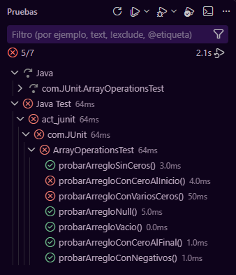
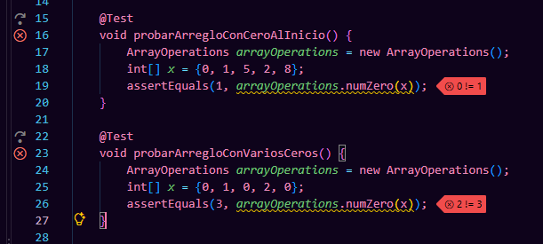

# Actividad Pruebas unitarias con JUnit

## Descripción

Esta actividad consiste en diseñar pruebas unitarias para el método `numZero()` de la clase `ArrayOperations`, utilizando **JUnit 6**. El método recibe un arreglo de enteros y debe devolver la cantidad de elementos cuyo valor es cero.

## Casos de prueba

| Prueba | Datos de entrada | Resultado esperado | Propósito |
|---|---|---|---|
| `probarArregloSinCeros` | `{1, 2, 3, 4}` | `0` | Verificar que no se cuenten valores distintos de cero. |
| `probarArregloConCeroAlInicio` | `{0, 1, 5, 2, 8}` | `1` | Verificar que se considere la primera posición. |
| `probarArregloConVariosCeros` | `{0, 1, 0, 2, 0}` | `3` | Comprobar el conteo de varios ceros. |
| `probarArregloNull` | `null` | `NullPointerException` | Verificar el manejo de una referencia nula. |
| `probarArregloVacio` | `{}` | `0` | Comprobar el comportamiento con un arreglo vacío. |
| `probarArregloConCeroAlFinal` | `{1, 2, 3, 0}` | `1` | Verificar que se cuente un cero en la última posición. |
| `probarArregloConNegativos` | `{-1, -2, 0, -3, -4, 0}` | `2` | Verificar que los números negativos no afecten el conteo de ceros. |

Cada prueba comprueba un comportamiento concreto y utiliza una entrada controlada. Se emplean las anotaciones `@Test` y las aserciones `assertEquals()` y `assertThrows()` de JUnit 6. Los casos abarcan arreglos sin ceros, ceros en distintas posiciones, varios ceros, valores negativos, un arreglo vacío y una referencia nula.

## Defecto identificado

En el método original se encuentra el siguiente ciclo:

```java
for (int i = 1; i < x.length; i++)
```

Como los arreglos comienzan en el índice `0`, el ciclo omite el primer elemento. Por ello, las pruebas con un cero en esa posición pueden detectar un resultado incorrecto. La corrección sería iniciar el recorrido en `i = 0`.

## Retos y aprendizajes

Uno de los retos de la actividad fue elegir entradas que permitieran comprobar comportamientos diferentes sin repetir innecesariamente el mismo caso. También fue importante distinguir entre un defecto del método y un valor esperado mal definido en una prueba.

La actividad permite comprender que una prueba fallida puede revelar un error real en el código fuente. Además, ayuda a familiarizarse con JUnit, las aserciones y la importancia de probar casos límite, como arreglos vacíos o referencias nulas.

## Capturas de las pruebas




## Uso de inteligencia artificial

Se utilizó inteligencia artifical como herramienta de apoyo para comprender el funcionamiento de las pruebas unitarias y de JUnit, y para revisar que los casos de prueba estuvieran implementados correctamente, 